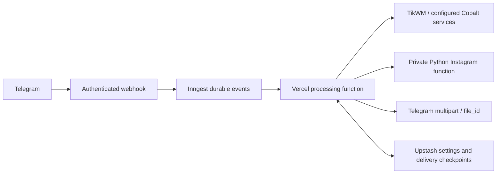

# Telegram media downloader

Downloads public TikTok, Instagram, YouTube, Twitter/X, Reddit, Threads and Pinterest media into Telegram. Supports captions, clean mode, document mode and photo/video albums. Instagram uses a direct anonymous browser-compatible extractor, with Cobalt as fallback. Other platforms use the configured scraper services.

## Runtime

Node.js 24.x, Python 3.12 (Instagram function), pnpm 10.33.0. Copy `.env.example` to `.env`, set the Telegram token and webhook secret.

```sh
pnpm install --frozen-lockfile
pnpm typecheck
pnpm test
pnpm build
```

`pnpm dev` switches the bot from its webhook to polling. Pending updates are preserved. `--drop-pending` is the explicit opt-in to discard them; use a separate development bot when production must remain available. Polling is sequential and intended for development.

## Free serverless deployment

The recommended architecture uses one Vercel Hobby project, Inngest Free and Upstash Redis Free. No permanent worker or VPS is required:



1. Create an Inngest Free account/app and Upstash Redis Free database. Keep them on free plans; no paid upgrade is required by this project.
2. Set `INNGEST_EVENT_KEY`, `INNGEST_SIGNING_KEY`, `UPSTASH_REDIS_REST_URL`, `UPSTASH_REDIS_REST_TOKEN` in Vercel, alongside the bot configuration.
3. Use Node.js 24 and Fluid Compute. `vercel.json` enables Fluid and gives `/api/inngest` a 300-second execution limit.
4. Deploy. Register/sync the deployed `/api/inngest` endpoint in Inngest. Allow this endpoint through deployment protection if enabled; the SDK verifies execution signatures.
5. Check a run in the Inngest dashboard, then register `/api/webhook` using `pnpm set-webhook https://YOUR-HOST/api/webhook`. Pending updates are retained.
6. Verify a real download in your own bot chat. Inline mode additionally requires `/setinline` in BotFather.

A webhook returns success only after Inngest accepts the event. Queue submission failure returns 503 for Telegram retry. Processing runs with global concurrency 4 and per-user concurrency 1, with bounded retries. Redis stores settings, quotas, completed updates and confirmed delivery steps; deduplication retention is 7 days. Confirmed sends survive ordinary retries. A process crash between a Telegram send and writing its checkpoint can still duplicate that send: Telegram provides no transactional idempotency key.

Without all four queue/state variables the bot retains a bounded synchronous mode: 50-second update deadline, temporary per-process settings, no durable replay protection. It is useful for migration/testing; the full reliability improvements require the free services above. Partial queue credentials fail configuration validation.

## Long and large videos

There is no 10-minute duration cutoff. Media is streamed to a temporary file and uploaded with multipart, rather than passed to Telegram as an HTTP URL. Downloaded bytes are not held as one large in-memory buffer. Temporary files are removed after upload or failure. URL validation, public DNS/IP pinning, redirect checks, byte caps and cancellation protect the downloader.

The standard Telegram Bot API permits up to 50 MB per uploaded video/document (10 MB for photos), whereas URL-based delivery permits only 20 MB for videos. If a video exceeds the configured upload cap, the bot tries the source's smaller TikTok stream or a Cobalt 480p rendition, while keeping the original download button. Smaller renditions are available only when the scraper supplies them. A 10-minute video may fit; duration alone cannot guarantee a file below 50 MB. Larger originals fall back to links. The 2000 MB local Bot API option requires a server and is intentionally outside this free deployment.

Video/document albums upload in batches of 2 to bound temporary disk use; photo albums use batches of 10. All batches are processed. Failed batches receive download buttons. Previously uploaded single files can reuse Telegram `file_id`, avoiding repeated transfer. Scraper results have a short 2-minute cache; concurrent identical requests share one lookup. Tracking parameters are removed from TikTok/Instagram resolution requests and cache identity.

## Scraper reliability

TikTok uses TikWM with Cobalt fallback. Instagram uses the private same-project Python extractor with Cobalt fallback; other platforms use configured Cobalt endpoints with failover. Queue mode retries temporary resolution failures once. HTTP 429, 5xx, body timeouts and malformed replies are handled. Media requiring unsupported local merging is rejected instead of sending a silent video-only stream.

`COBALT_API_KEY` is sent only to the primary configured endpoint. API redirects are rejected. Fallback instances must be authorized for your use and operated appropriately; their presence does not provide an uptime guarantee. Do not rotate arbitrary public instances or bypass their authentication/bot protection.

Instagram extraction was repaired on 2026-10-15: the current logged-out GraphQL query uses a numeric media ID and browser-compatible TLS/HTTP2 through pinned Python `curl_cffi==0.16.3` in a private function of the same Vercel project. The Python function uses fresh anonymous cookies and verified TLS, with redirects disabled and streamed metadata size limits; no Instagram account, paid proxy or separate server is needed. Python 3.12 and the compatible manylinux wheel avoid Node native-addon/glibc incompatibility. Node calls the private function using the existing webhook secret; it does not send the Telegram bot token. Cobalt remains a fallback for extraction/transport failures.

The supplied `DeXA5froeiC` reel was downloaded through the application extractor and streaming downloader: 10,404,586-byte MP4, H.264 video + AAC audio, 106.14 seconds. `Dd-4gKENRms` has an explicit Instagram age gate, independently confirmed in Chrome without login; the bot now explains that restriction rather than reporting an outage. Age-gated/private media requires an authorized Instagram account and is outside anonymous extraction. For local checks, set `INSTAGRAM_EXTRACTOR_URL` to this project’s `/api/instagram` URL. Reproduce with `pnpm exec tsx scripts/probe-instagram-direct.ts` (requires ffprobe); sanitized results are in `audit/instagram-direct-live.jsonl`.

Instagram's undocumented query and access policies can change; no extractor can guarantee access to every post. Monitor extraction failures and keep the query/transport current.

## Checks and operations

`pnpm test` runs portable regression tests, excluding generated `dist` tests. Python regression tests: install `requirements.txt` in a Python 3.12 virtual environment, then run `python -m unittest discover -s tests -p 'test_instagram_python.py' -v`. `pnpm test:integration` runs Redis persistence/Lua/concurrency tests against a disposable local Redis server; `redis-server` and `redis-cli` are required (override with `REDIS_SERVER_BIN` / `REDIS_CLI_BIN`). It never connects to the production Redis database.

Logs use update IDs and error codes rather than full user URLs or tokens. Check Vercel function logs, failed Inngest runs, Telegram `getWebhookInfo`, and Upstash usage before a quota is exhausted. Free tiers have finite quotas; the app cannot guarantee unlimited throughput or uninterrupted service after those limits.

Current published limits: [Inngest Free: 50,000 executions/month and 5 concurrent steps](https://www.inngest.com/pricing); [Upstash Redis Free: 250 MB and 500,000 commands/month](https://upstash.com/pricing/redis). A function run plus its step uses multiple executions, so 50,000 executions is not 50,000 downloads. Vercel compute/network quotas may be the earlier bottleneck. Multiple Vercel projects do not remove Telegram limits or scraper failures.

Protocol references: [Telegram sending files](https://core.telegram.org/bots/api#sending-files), [Vercel duration limits](https://vercel.com/docs/functions/configuring-functions/duration), [Cobalt API contract](https://github.com/imputnet/cobalt/blob/main/docs/api.md).

See `AUDIT_REPORT.md` for findings, fixes, verification and remaining external requirements. The fixes are deployed to `telegram-video-bot-peach.vercel.app`. Production extraction + MP4 download of `DeXA5froeiC` passed (10,404,586 bytes, ~1.4 seconds); the age gate on `Dd-4gKENRms` is identified separately. Evidence: `audit/instagram-production-live.jsonl`. Queue/state services remain optional and are not activated without their credentials.
